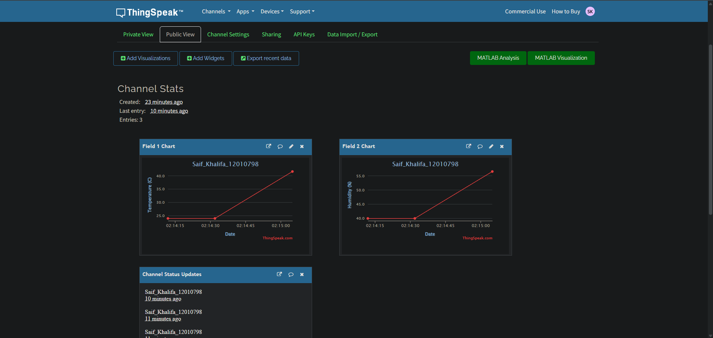
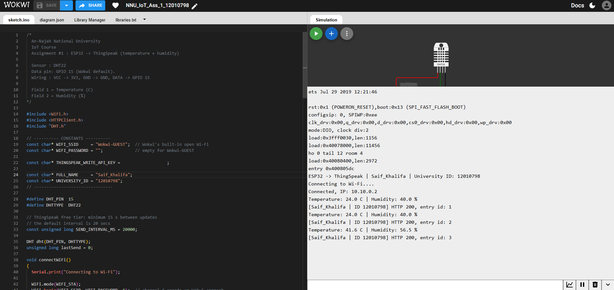

# IoT-Playground — ESP32 → ThingSpeak: Live Temperature & Humidity

> **Notice:** This repository is intended for **course submissions only** (Internet of Things,
> An-Najah National University). It is licensed under the [MIT License](LICENSE). The author
> (Saif Khalifa) and An-Najah National University are **not responsible** for any use of this
> repository or its contents, which are provided "as is" without warranty of any kind.

**Name:** Saif Khalifa  
**University ID:** 12010798  
**Course:** Internet of Things — An-Najah National University  
**Assignment:** #1 — ESP32 → ThingSpeak

## Project description

An ESP32 reads temperature and humidity from a DHT22 sensor and uploads the readings to a
ThingSpeak channel every 20 seconds over Wi-Fi using the ThingSpeak HTTP update API
(the free tier requires at least 15 s between updates). ThingSpeak's built-in charts display the
data as live graphs on a public channel page.

The project is simulated in [Wokwi](https://wokwi.com/) (ESP32 + DHT22, internet via `Wokwi-GUEST`).

| ThingSpeak field | Meaning          |
|------------------|------------------|
| Field 1          | Temperature (°C) |
| Field 2          | Humidity (%)     |

Every update also carries `Saif_Khalifa_12010798` in the `status` parameter, and the same
identifier is printed in the serial log.

Example request:

```
http://api.thingspeak.com/update?api_key=XXXX&field1=23.5&field2=44.0&status=FirstName_LastName_UniversityID
```

## Links

- **ThingSpeak public channel:** https://thingspeak.com/channels/3552004
- **Wokwi project:** https://wokwi.com/projects/478990430948728833

## Wiring / schematic

| DHT22 pin  | ESP32 pin |
|------------|-----------|
| VCC        | 3V3       |
| GND        | GND       |
| DATA (SDA) | GPIO 15   |

The Wokwi schematic is in [diagram.json](NNU_IoT_Ass_1_12010798/diagram.json).

## How it works

1. Connects to Wi-Fi (`Wokwi-GUEST`).
2. Every 20 s, reads the DHT22 (the cycle is skipped if the read fails).
3. Sends a `GET` request to the ThingSpeak update endpoint with both fields and the status.
4. Prints the response: ThingSpeak returns the new entry ID, or `0` if the update was rejected.

## Screenshots

**ThingSpeak channel (public view) — live temperature and humidity graphs**



**Wokwi circuit and serial log**



## Repository layout

```
NNU_IoT_Ass_1_12010798/
├── sketch.ino          # ESP32 firmware
├── diagram.json        # Wokwi circuit definition
├── libraries.txt       # DHT sensor library, Adafruit Unified Sensor
├── wokwi-project.txt   # Wokwi project link
├── Docs/               # Assignment brief (PDF)
└── Screenshots/        # ThingSpeak channel page, Wokwi circuit + serial log
```

## How to run

1. Open the Wokwi project (link above).
2. In `sketch.ino`, set `THINGSPEAK_WRITE_API_KEY` to your own channel's Write API key
   (and `FULL_NAME` / `UNIVERSITY_ID` if they differ).
3. Press **Start Simulation** and watch the serial monitor for `HTTP 200` and a non-zero entry id.
4. Open your channel's public URL to see the graphs updating.

> The Write API key in the committed code is a placeholder, so you need your own ThingSpeak
> channel and key to see data on your own channel. This avoids abuse of the shared ThingSpeak
> free tier.

## License

Released under the [MIT License](LICENSE) © 2026 Saif Khalifa. See the notice at the top of this file.
